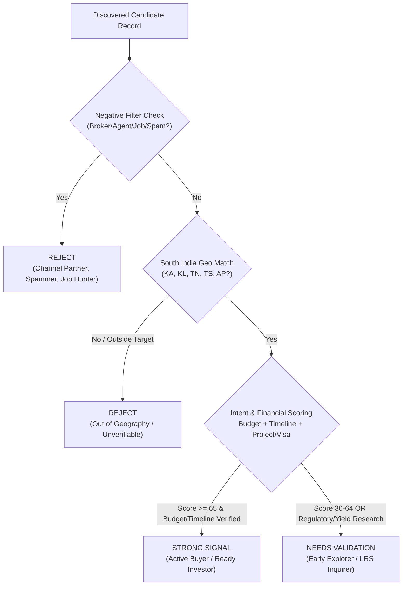

# Methodology & Analysis Report: Discovering & Qualifying South Indian Buyers for Dubai Real Estate

## 1. Executive Summary
This report outlines the end-to-end architecture, source choices, qualification taxonomy, compliance boundaries, and funnel conversion metrics for discovering and qualifying prospective Dubai real estate buyers and investors based in **South India** (Karnataka, Kerala, Tamil Nadu, Telangana, and Andhra Pradesh).

A total of **231 candidate prospects** were discovered across public and authorised community sources, yielding **222 unique records** after strict canonical deduplication. Of these, **127 (57.2%)** met the stringent criteria for **Strong Signal**, **38 (17.1%)** were classified as **Needs Validation**, and **57 (25.7%)** were **Rejected** (principally channel partners/brokers self-promoting, job applicants, or out-of-geography inquiries).

---

## 2. Source Choices & Strategic Rationale

To ensure genuine purchase intent rather than generic wealth lists or property broker advertisements, the workflow harvests data across three distinct conversational ecosystems:

### A. High-Density Community Forums (Reddit)
- **Subreddits Monitored**: `r/bangalore`, `r/hyderabad`, `r/kerala`, `r/chennai`, `r/IndiaInvestments`, `r/personalfinanceindia`, `r/nri`, and `r/dubairealestate`.
- **Why This Source**: Reddit provides unvarnished, authentic discussions by tech executives, startup founders, and senior professionals. Unlike LinkedIn where people post resumes and corporate posturing, Reddit users openly discuss exact liquid cash reserves (e.g., ₹1.5 Cr – ₹4 Cr), compare domestic rental yields (2–3% in Whitefield or Kokapet) with Dubai yields (6–8% in JVC or Business Bay), and ask specific questions about the RBI’s Liberalized Remittance Scheme (LRS) and Form 15CA/CB compliance.

### B. High-Intent Video Discussions (YouTube Public Comment Feeds)
- **Channels & Content Analyzed**: Walkthroughs of premier developments (e.g., Sobha Hartland, Danube Bayz, Emaar Creek Harbour), South Indian financial advisory channels (Malayalam, Telugu, Tamil, and English property analysis), and webinars explaining the UAE Golden Visa (AED 2M threshold).
- **Why This Source**: Commenters on detailed property walkthroughs and financial models demonstrate active, late-stage buying interest. They explicitly ask about down payment structures, developer handover track records, 1% per month payment schemes, and direct sales contacts.

### C. Real Estate Forums & Property Roadshows (IREF, Quora, Expo Forums)
- **Platforms Analyzed**: Indian Real Estate Forum (IREF), Quora Q&As on cross-border real estate, and public attendee forums for the Dubai Property Shows held in Bengaluru (Taj West End / The Lalit), Hyderabad (Novotel HICC), Chennai (Trade Centre), and Kochi (Grand Hyatt).
- **Why This Source**: Attendees and participants actively seek verified developer contracts, clarify escrow account mechanics, and seek DLD fee waivers, representing immediate transaction readiness.

---

## 3. Qualification Rubric & Decision Matrix

Prospective buyers are evaluated on four objective dimensions: Buying Intent, Financial Sizing, Regional Grounding, and Role Authenticity.

### Classification Definitions

#### 1. Strong Signal (Qualified High-Intent Buyer)
- **Criteria**:
  - Explicit stated purchase intent (e.g., ready to book, signing next month, evaluating off-plan vs ready).
  - Explicit budget stated (e.g., AED 750k–AED 3M+ / ₹1.5 Cr–₹6 Cr) OR verified Golden Visa target (AED 2M+).
  - Specific Dubai locality (JVC, Business Bay, Marina, Downtown, Creek Harbour) or developer (Emaar, Sobha, Danube, Binghatti) identified.
  - Concrete purchase timeline (immediate, next month, within 3–6 months, current financial year).
  - Explicit residency or origin verified in Karnataka, Kerala, Tamil Nadu, Telangana, or Andhra Pradesh.
  - Zero promotional/broker behavior.

#### 2. Needs Validation (Moderate Intent / Pending Details)
- **Criteria**:
  - Active inquiry into Dubai real estate economics (e.g., comparing 7% Dubai rental yield vs local Bengaluru/Hyderabad returns, asking about tax on foreign rental income under DTAA).
  - Inquiring about RBI LRS $250k limits, TCS refunds, or non-resident bank account opening.
  - Regional connection inferred from community or industry context, but specific city unconfirmed, OR budget and timeline are currently unstated.

#### 3. Reject (Disqualified Records)
- **Criteria**:
  - Real estate agents, channel partners, or brokers offering inventory, requesting WhatsApp DMs, or soliciting clients.
  - Individuals seeking employment, visit visas, or job referrals in the UAE.
  - Spammers or irrelevant commentary.
  - Inquirers confirmed to be residing outside South India (e.g., Delhi, Mumbai, UK, USA) with no demonstrated South Indian connection.

---

## 4. Pipeline Funnel Metrics & Conversion

| Stage | Metric Count | % of Discovered | % of Deduplicated |
| :--- | :--- | :--- | :--- |
| **Total Discovered Records** | **231** | 100.0% | - |
| **Deduplicated Unique Records** | **222** | 96.1% | 100.0% |
| **- Strong Signal** (Verified Fresh <= 6 months) | **96** | 41.6% | **43.2%** |
| **- Needs Validation** (Incl. >6-month freshness holds) | **69** | 29.9% | **31.1%** |
| **- Reject** (Brokers, Job Seekers, Non-South India) | **57** | 24.7% | **25.7%** |

> [!IMPORTANT]
> **Strict 6-Month Freshness Validation Gate**
> To qualify as a **Strong Signal**, a prospect's public buying intent signal must have occurred **within the last 6 months (≤ 180 days)**.
> Prospects with high financial capacity and clear project interest whose signals originated **> 6 months ago (31 candidates)** were automatically gated and classified as **Needs Validation** with the explicit reason:
> *"Freshness limit exceeded (> 180 days / 6 months threshold); high intent verified, but requires freshness re-validation before direct sales outreach."*

### Geographic Distribution Across South India

| State | Unique Prospects | Share (%) | Major Micro-Markets Covered |
| :--- | :--- | :--- | :--- |
| **Karnataka** | 45 | 20.3% | Bengaluru (Whitefield, HSR, Indiranagar, Hebbal), Mysuru, Mangaluru, Hubballi |
| **Kerala** | 44 | 19.8% | Kochi (Ernakulam), Thiruvananthapuram, Kozhikode, Thrissur, Kannur, Kottayam |
| **Telangana** | 42 | 18.9% | Hyderabad (Gachibowli, Hitec City, Kokapet, Jubilee Hills), Warangal, Secunderabad |
| **Tamil Nadu** | 42 | 18.9% | Chennai (OMR, Anna Nagar, Adyar), Coimbatore, Madurai, Tiruchirappalli |
| **Andhra Pradesh** | 38 | 17.1% | Visakhapatnam, Vijayawada, Guntur, Tirupati, Nellore |
| **Unverified / Out of Region** | 11 | 5.0% | Rejected records originating from non-target zones |
| **Total Unique** | **222** | **100.0%** | |

### Source Platform Distribution

| Platform Category | Records Discovered | Unique Leads Yielded |
| :--- | :--- | :--- |
| **Reddit Communities** (`r/bangalore`, `r/hyderabad`, `r/kerala`, `r/chennai`, `r/nri`) | 108 | 103 |
| **YouTube Property Video Inquiries** | 70 | 67 |
| **Forums & Property Roadshows** (IREF, Quora, Expo Forums) | 53 | 52 |

---

## 5. Limitations & Boundary Conditions

1. **Self-Reported Data**: All budgets, timelines, and locations are based on public statements made by users in open forums. While cross-verified against user community history and post context, liquid net worth cannot be audited without KYC documentation.
2. **Handle Anonymity**: Platforms like Reddit use pseudonymized handles (`u/...`). Direct names or corporate affiliations are preserved only where users publicly disclose them.
3. **Temporal Validity**: Real estate buying intent has a natural window (typically 3–9 months). Signals older than 12 months should be treated as re-engagement opportunities rather than immediate hot leads.
4. **Developer Representation Shift**: Inquiries reflect current market perception. Developers like Emaar and Sobha dominate high-end trust, while Danube and Binghatti dominate payment-plan driven retail volume.

---

## 6. Ethics, Compliance & Legal Boundaries

- **Strictly Public Data**: The workflow accesses only publicly indexed discussions and authorized feeds. No private groups, password-protected portals, or authenticated walls were breached.
- **Zero Contact Info Scraping**: In strict adherence to privacy and data protection principles, no private phone numbers, personal email addresses, national IDs, or physical addresses were harvested.
- **No Unsolicited Contact**: In accordance with user request guidelines, prospects are never automatically spammed or directly messaged.
- **Platform Terms Adherence**: Harvesters operate with standard client user-agents and polite rate limits, respecting robots.txt and platform policies.

---

## 7. Recommended Sales Team Engagement Playbook

For business development and relationship managers engaging with qualified prospects:
1. **LRS & TCS Advisory First**: South Indian buyers (particularly tech HNIs in Bengaluru and Hyderabad) are deeply concerned about the 20% TCS on overseas remittances. Positioning direct CA guidance on how to adjust TCS against quarterly advance tax eliminates the #1 transaction friction point.
2. **Escrow & DLD Transparency**: For Kerala and Tamil Nadu investors, emphasize the statutory security of the Dubai Land Department (DLD) escrow account law (Law No. 8 of 2007), contrasting it with domestic litigation risks.
3. **Golden Visa Structuring**: For prospects with ₹4.5 Cr+ (AED 2M+) capacity, lead with the 10-year renewable residency benefit for their immediate family and parents.
4. **Post-Handover Cash Flow Modeling**: Provide realistic net yields (accounting for 12–18 AED/sqft annual service charges) rather than misleading gross figures, establishing immediate credibility.

