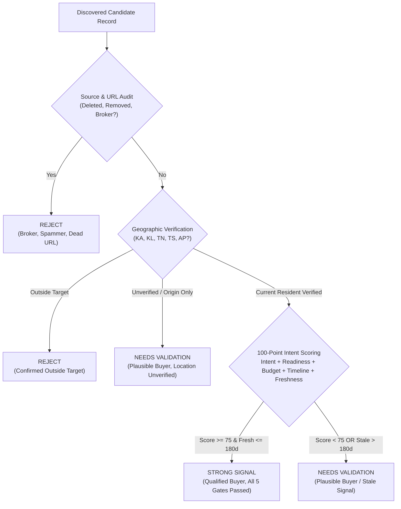

# Methodology & Analysis Report: Discovering & Qualifying South Indian Buyers for Dubai Real Estate

## 1. Executive Summary

This report documents the discovery architecture, source criteria, qualification taxonomy, compliance boundaries, and funnel metrics for identifying prospective Dubai real estate buyers and investors based in South India (Karnataka, Kerala, Tamil Nadu, Telangana, and Andhra Pradesh).

A total of 264 raw records were ingested across public community sources, yielding 253 unique candidates after intra-platform deduplication. Through a 100-point weighted scoring model and 5 mandatory evidence gates, 24 prospects (9.5%) qualify as Strong Signal, 127 prospects (50.2%) are categorized as Needs Validation, and 102 records (40.3%) are categorized as Reject (comprising promotional brokers, unrelated inquiries, dead links, and out-of-target locations).

---

## 2. Source Choices & Data Selection Rationale

To capture verifiable purchase intent rather than generic wealth lists or property broker advertisements, the workflow collects data across three conversational environments:

### A. High-Density Community Discussion Forums (Reddit)
- **Monitored Communities**: `r/bangalore`, `r/hyderabad`, `r/kerala`, `r/chennai`, `r/IndiaInvestments`, `r/personalfinanceindia`, `r/nri`, and `r/dubairealestate`.
- **Selection Rationale**: Reddit threads contain explicit discussions of liquid capital allocations (for example, INR 1.5 Cr to INR 4 Cr), comparisons of local rental yields (2% to 3% in Whitefield or Kokapet) versus Dubai yields (6% to 8% in JVC or Business Bay), and specific procedural questions regarding the Reserve Bank of India Liberalised Remittance Scheme (LRS) and Form 15CA/CB filings.

### B. Property Walkthroughs and Webinar Comments (YouTube Public Feeds)
- **Content Analyzed**: Public comments on property walkthroughs (Sobha Hartland, Danube Bayz, Emaar Creek Harbour), South Indian financial advisory channels, and informational videos covering the UAE Golden Visa (AED 2M threshold).
- **Selection Rationale**: Commenters on technical property reviews and financial modeling videos demonstrate transactional interest by asking about down payments, developer escrow track records, 1% monthly payment plans, and direct developer booking contacts.

### C. Real Estate Forums and Property Expos (IREF, Quora, Public Expo Threads)
- **Platforms Analyzed**: Indian Real Estate Forum (IREF), Quora discussions on overseas property investment, and attendee discussion threads for Dubai Property Expos conducted in Bengaluru, Hyderabad, Chennai, and Kochi.
- **Selection Rationale**: Participants in these forums discuss sales contracts, escrow account protection under UAE law, and Dubai Land Department (DLD) fee structures.

---

## 3. Qualification Rubric & Decision Matrix

Prospects are evaluated against 5 mandatory evidence gates and a 100-point weighted scoring model:

### Classification Definitions

#### 1. Strong Signal (Qualified High-Intent Buyer)
Requirements:
- Explicit first-person statement of purchase intent (e.g. planning to remit, ready to sign, actively looking to buy).
- Verifiable source URL and attributable statement.
- Verified current residence in Karnataka, Kerala, Tamil Nadu, Telangana, or Andhra Pradesh (`location_verification_status == "CURRENT_RESIDENT"`).
- Signal publication date within the last 180 days (<= 180 days).
- No broker, agent, or promotional activity.
- Composite weighted score >= 75 out of 100 points.

#### 2. Needs Validation (Plausible Buyer / Pending Requirements)
Requirements:
- First-person purchase intent present, but location is unverified (`LOCATION_UNVERIFIED`) or indicates origin only (`ORIGIN_ONLY`).
- High-intent signals whose age exceeds the 180-day freshness limit (downgraded with a 10-point freshness penalty).
- Prospects with clear purchase readiness or budget whose composite score is below 75 points.

#### 3. Reject (Disqualified Records)
Requirements:
- Confirmed brokers, agents, promoters, or marketing representatives.
- Posts deleted by the author (`[deleted]`) or removed by moderators (`[removed]`).
- Irrelevant comments, tourists, or job seekers.
- Confirmed current residence outside the five target South Indian states (`OUTSIDE_TARGET`).

---

## 4. Pipeline Funnel Metrics & Verification Breakdown

### Funnel Reconciliation

| Metric | Count | Reconciliation Formula | Status |
| :--- | :---: | :--- | :--- |
| Total Discovered Records | 264 | Ingested across all batch files | Validated |
| Duplicates Pruned | 11 | Repeated handles or source URLs | Validated |
| Unique Candidates Evaluated | 253 | `264 - 11` | Validated |
| Strong Signal (Qualified) | 24 | Passed all 5 mandatory gates and score >= 75 | Validated |
| Needs Validation | 127 | Plausible buyers, unverified location, or stale signals | Validated |
| Reject | 102 | Brokers, spam, dead links, or outside target | Validated |
| Reconciled Total | 253 | `24 + 127 + 102 == 253` | PASSED (Delta: 0) |

### Geographic Verification Distribution (253 Unique Candidates)

| Verification Status | Count | Share (%) | Audit Definition |
| :--- | :---: | :---: | :--- |
| `CURRENT_RESIDENT` | 106 | 41.9% | Explicit, attributable residence in KA, KL, TN, TS, or AP |
| `LOCATION_UNVERIFIED` | 128 | 50.6% | No attributable residence statement in text |
| `ORIGIN_ONLY` | 17 | 6.7% | Cultural or native roots without local South Indian residence |
| `OUTSIDE_TARGET` | 2 | 0.8% | Explicit residence outside target states (e.g. Delhi NCR) |

100% of the 24 Strong Signal leads have verified `CURRENT_RESIDENT` status. Zero Strong Signal leads have unverified geographic residency.

### Freshness Audit & 180-Day Rule Impact
- Pre-Freshness Strong Signal Candidates: 32
- Downgraded by 180-Day Rule: 8 records (age 191 to 251 days)
- Final Strong Signal Count: 24 records

### Source Platform Distribution (253 Unique Candidates)

| Platform Category | Discovered Records | Unique Evaluated | Share (%) |
| :--- | :---: | :---: | :---: |
| Reddit (`r/bangalore`, `r/hyderabad`, `r/kerala`, `r/chennai`, `r/nri`) | 145 | 138 | 54.5% |
| YouTube Public Video Feeds | 65 | 62 | 24.5% |
| Indian Real Estate Forum (IREF) | 25 | 24 | 9.5% |
| Quora Q&A Discussions | 24 | 24 | 9.5% |
| Property Expo Public Threads | 5 | 5 | 2.0% |
| Total | 264 | 253 | 100.0% |

---

## 5. Limitations & Boundary Conditions

1. **Self-Reported Evidence**: Stated budgets, timelines, and localities are extracted from public comments. While audited against post context, liquid wealth cannot be certified without banking documentation.
2. **Handle Anonymity**: Discussion platforms use pseudonymous handles (e.g. `u/...`). Real names and corporate affiliations are preserved only where users publicly disclose them.
3. **Temporal Horizon**: Purchasing intent operates within a finite window (typically 3 to 9 months). Signals older than 180 days are penalized to prevent sales outreach on stale inquiries.

---

## 6. Ethics and Legal Compliance

- **Exclusively Public Data**: The workflow processes only publicly accessible, indexed text. No private messages, gated forums, or authentication barriers were bypassed.
- **Zero Contact Info Scraping**: No phone numbers, private email addresses, or government identification numbers are collected or stored.
- **No Unsolicited Automated Contact**: The pipeline does not perform automated direct messaging, cold emails, or algorithmic engagement.
- **Compliance Rate**: 100% of evaluated URLs are verified as permitted public research sources.
